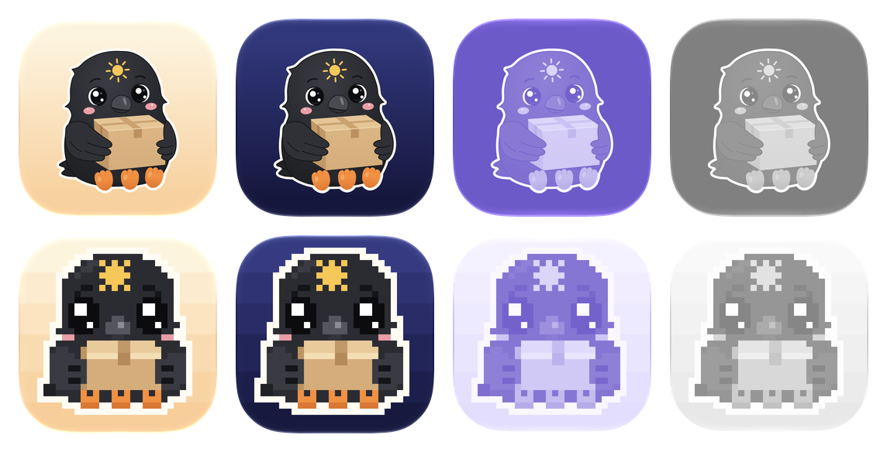

# App icon

Yatagarasu's mascot is the three-legged sun crow carrying a parcel. The app ships two
icons built from the same drawing:

| Icon | Package | Role |
| --- | --- | --- |
| Classic | `yatagarasu/Resources/AppIcon.icon` | Primary app icon (Finder, Dock, App Switcher) |
| Pixel | `yatagarasu/Resources/PixelAppIcon.icon` | Alternate icon, chosen in Settings › General |



## Files

- `reference.webp`: the sticker illustration the character is redrawn from.
- `tools/crow.py`: the vector character, drawn in the reference's 1024×1024 coordinates.
- `tools/pixel.py`: the same character as a hand-placed 32×32 sprite.
- `tools/build.py`: renders both into Icon Composer packages in `yatagarasu/Resources/`
  and writes `previews/` with Xcode's `ictool`.

Each `.icon` has a background (sunrise in light mode, night sky in dark mode) and the
crow with a cream sticker outline; the sun is the mark on its forehead. Layers are flat
(no Liquid Glass), so the illustration stays crisp; the system still adds the icon's edge
lighting and generates the tinted and clear variants.

## Rebuilding

```bash
cd apps/macos/design/app-icon/tools
uv run --no-project --with skia-python --with pillow --with numpy python build.py
```

Edit the drawing in `crow.py` / `pixel.py`, rebuild, then open the packages in Icon
Composer if you want to fine-tune glass, shadows or appearances by hand. Rebuilding
overwrites those packages, so copy any hand edits back into `build.py`.

## How the alternate icon works

macOS has no alternate-icon API, so the Pixel icon only changes the Dock icon while the
app runs (`App/AppIconStyle.swift` sets `NSApp.applicationIconImage`). The target's
`ASSETCATALOG_COMPILER_ALTERNATE_APPICON_NAMES = PixelAppIcon` build setting compiles it
into the asset catalog, where `NSImage(named: "PixelAppIcon")` returns a Dock-ready image
with the standard macOS margins and shadow. Finder always shows the Classic icon.
